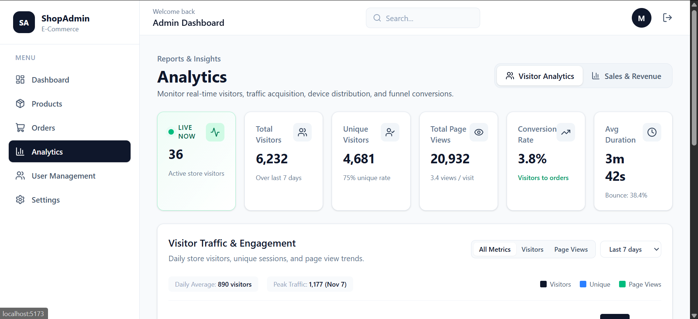
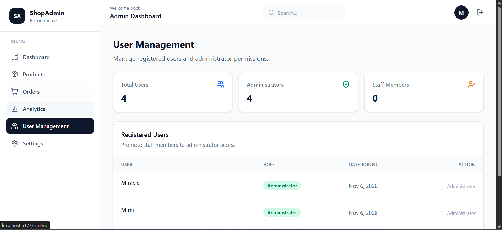
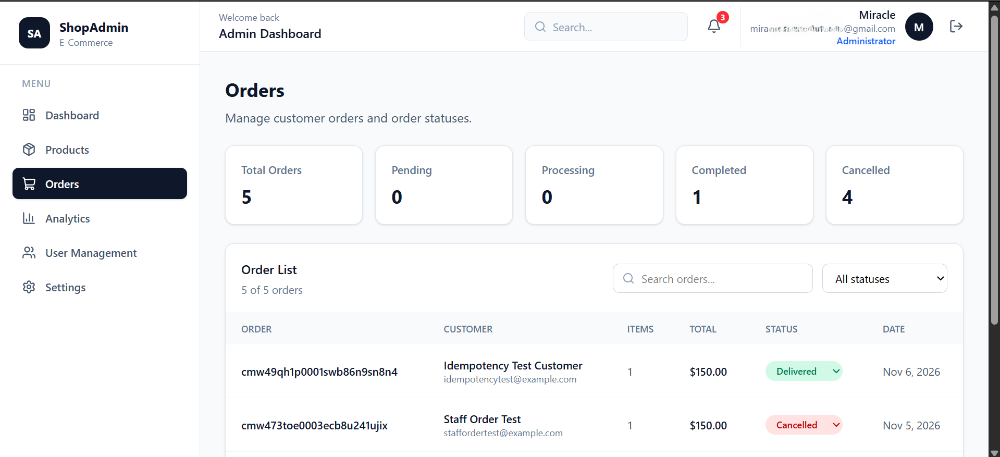

# E-Commerce Admin & Real-Time Analytics Dashboard

A full-stack e-commerce administration platform built to help store administrators manage products, monitor orders, oversee users and sessions, and understand store performance through analytics.

The application combines a responsive **React and TypeScript** dashboard with a **Node.js and Express** REST API and a **PostgreSQL** database. It includes authentication, role-based access control, session management, and analytics capabilities.

## Project Status

**Live and actively under development.**

- Frontend deployed on Vercel.
- Backend deployed on Render.
- PostgreSQL database hosted on Neon.
- Frontend and backend integrated in the production environment.
- Additional features and improvements are ongoing.

**[View the live application](https://ecommerce-admin-dashboard-sigma-pearl.vercel.app/)**

## Features

### Dashboard and Store Management

- **Dashboard Overview:** Monitor key store metrics, sales summaries, and recent orders.
- **Product Management:** Create, view, update, and delete products.
- **Order Management:** Review orders, inspect order details, and update order statuses.
- **Analytics:** Explore store performance and business metrics.

### Authentication and Security

- **User Authentication:** Registration, login, and logout.
- **Role-Based Access Control:** Separate administrator and staff permissions.
- **Secure Authentication:** Password hashing and HTTP-only authentication cookies.
- **Session Management:** View active sessions, monitor login history, revoke individual sessions, and log out from all devices.
- **Protected Routes:** Restrict access to resources based on authentication and user roles.

### User and Visitor Management

- **User Management:** View registered users and manage administrator and staff access.
- **Visitor Analytics:** Track visitor activity and page views.
- **Traffic Insights:** Review available visitor and traffic metrics.

### User Experience and Quality

- **Notifications:** Reusable notifications for application feedback.
- **Responsive Design:** Layouts designed for desktop and mobile screens.
- **Form Validation:** Validate user input across application forms.
- **Error Handling:** React error boundaries and API response handling.
- **Automated Testing:** Frontend unit and component tests using Vitest and React Testing Library.

## Technology Stack

### Frontend

| Technology | Purpose |
|---|---|
| React 19 | User interface |
| TypeScript | Type safety |
| Vite | Development server and build tool |
| React Router 7 | Application routing |
| TanStack Query v5 | Server-state management |
| Tailwind CSS v4 | Styling |
| shadcn/ui with Base UI | UI components |
| Lucide React | Icons |
| Vitest | Testing |
| React Testing Library | Component testing |
| MSW | API mocking during development and testing |
| ESLint | Code quality and linting |

### Backend

| Technology | Purpose |
|---|---|
| Node.js | JavaScript runtime |
| Express 5 | REST API |
| TypeScript | Type safety |
| PostgreSQL | Relational database |
| Neon | Managed PostgreSQL hosting |
| Prisma 7 | ORM and database migrations |
| bcryptjs | Password hashing |
| JSON Web Tokens (JWT) | Authentication tokens |
| Zod | Request validation |
| Helmet | HTTP security headers |
| CORS | Cross-origin request handling |

### Deployment and Infrastructure

| Service | Purpose |
|---|---|
| Vercel | Frontend hosting and API proxy rewrites |
| Render | Backend hosting |
| Neon | Hosted PostgreSQL database |

## Architecture

The application is organised into three main parts:

1. **Frontend:** The React application provides the dashboard interface and sends API requests.
2. **Backend:** The Express API handles authentication, authorization, business logic, and database operations.
3. **Database:** PostgreSQL stores application data, accessed through Prisma.

In production, the frontend sends API requests through same-origin `/api` paths. Vercel rewrites those requests to the Render-hosted backend. Authentication uses HTTP-only cookies so the browser can include the session cookie with protected API requests.

For local development, the Vite development server proxies `/api` requests to the backend at `http://localhost:5000`.

## Project Structure

```text
ecommerce-admin-dashboard/
├── public/
├── screenshots/
├── server/
│   ├── prisma/
│   │   ├── migrations/
│   │   └── schema.prisma
│   ├── src/
│   │   ├── config/
│   │   ├── controllers/
│   │   ├── middleware/
│   │   ├── routes/
│   │   ├── utils/
│   │   └── server.ts
│   ├── package.json
│   └── prisma.config.ts
├── src/
│   ├── components/
│   ├── hooks/
│   ├── pages/
│   ├── services/
│   └── main.tsx
├── index.html
├── package.json
├── vercel.json
└── README.md
```

## Getting Started

### Prerequisites

Make sure you have the following installed:

- [Node.js](https://nodejs.org/)
- npm
- [Git](https://git-scm.com/)
- A PostgreSQL database, such as [Neon](https://neon.com/)

### 1. Clone the repository

```bash
git clone https://github.com/MiMi-Tech19/ecommerce-admin-dashboard.git
cd ecommerce-admin-dashboard
```

### 2. Install frontend dependencies

From the project root:

```bash
npm install
```

### 3. Configure the frontend environment

The Vite development server is configured to proxy `/api` requests to `http://localhost:5000`, so the frontend does not need a separate API base URL for local development.

Create a `.env` file in the project root and add:

```env
VITE_ENABLE_MSW=false
```

Set `VITE_ENABLE_MSW=true` only when you intentionally want to use the mock service worker for local development or testing. Keep it disabled in production so requests reach the real backend.

### 4. Configure and start the backend

Open a second terminal and navigate to the server directory:

```bash
cd server
npm install
```

Create a `.env` file inside `server`:

```env
PORT=5000
NODE_ENV=development

DATABASE_URL="your-neon-pooled-connection-string"
DIRECT_URL="your-neon-direct-connection-string"

JWT_SECRET="your-long-random-secret"

CLIENT_URL="http://localhost:5173"
```

Replace the example values with your own database connection strings and secret. Do not commit real credentials or environment files.

Generate the Prisma client and apply the existing migrations:

```bash
npx prisma generate
npx prisma migrate deploy
```

Start the backend:

```bash
npm run dev
```

The API will usually be available at `http://localhost:5000`.

### 5. Start the frontend

In the project-root terminal:

```bash
npm run dev
```

The frontend will usually be available at `http://localhost:5173`.

### 6. Verify the backend

API health check:

```text
http://localhost:5000/api/health
```

Database health check:

```text
http://localhost:5000/api/health/database
```

## Available Scripts

### Frontend

Run these commands from the project root.

| Command | Description |
|---|---|
| `npm run dev` | Starts the frontend development server |
| `npm run build` | Runs TypeScript checks and creates a production build |
| `npm run lint` | Runs ESLint |
| `npm run test:run` | Runs the automated test suite |

### Backend

Run these commands from the `server` directory.

| Command | Description |
|---|---|
| `npm run dev` | Starts the backend development server |
| `npm run build` | Compiles the backend TypeScript |
| `npm start` | Starts the compiled backend |
| `npm run typecheck` | Runs TypeScript type checking |
| `npm run lint` | Runs ESLint |
| `npm run seed:admin` | Runs the administrator seed script |

## API Overview

The backend exposes REST API routes for the application's core functionality.

| Endpoint | Purpose |
|---|---|
| `/api/auth` | Registration, login, logout, and current user |
| `/api/products` | Product management |
| `/api/orders` | Order management |
| `/api/analytics` | Store analytics |
| `/api/users` | User management |
| `/api/sessions` | User session management |
| `/api/admin/sessions` | Administrator session monitoring |
| `/api/health` | API health check |
| `/api/health/database` | Database connectivity check |

## Testing and Quality Assurance

The frontend uses Vitest and React Testing Library for automated tests.

Run the following commands from the project root:

```bash
npm run test:run
npm run lint
npm run build
```

The backend also supports independent type checking, linting, and production builds. Run these commands from the `server` directory:

```bash
npm run typecheck
npm run lint
npm run build
```

## Deployment

The application is deployed as separate frontend and backend services, with a hosted PostgreSQL database.

- **Frontend (Vercel):** [Open the live dashboard](https://ecommerce-admin-dashboard-sigma-pearl.vercel.app/)
- **Backend (Render):** [https://ecommerce-admin-api-8nw6.onrender.com](https://ecommerce-admin-api-8nw6.onrender.com)
- **Database (Neon):** Managed PostgreSQL hosting.

The production frontend uses Vercel rewrites to forward `/api` requests to the Render backend. Production environment variables are configured in the hosting platforms rather than committed to the repository.

## Screenshots

### Dashboard Overview


### Analytics

The analytics dashboard provides visitor, traffic, engagement, and sales insights.



### User Management

The user management page displays registered accounts and role information for administrators and staff.



### Product Management


### Order Management



## What's Next

This project is still actively being developed. Planned work includes:

- Adding more dashboard and administration features.
- Expanding analytics and reporting capabilities.
- Improving the mobile experience and accessibility.
- Strengthening automated and integration test coverage.
- Continuing to refine performance, security, and overall usability.

## About the Project

I started this project as a frontend development exercise and challenged myself to take it further by learning backend development while building. Working with Node.js, Express, Prisma, and PostgreSQL helped me understand how the frontend and backend communicate and how a complete application is put together.

This has been a valuable learning experience in building, testing, debugging, deploying, and improving a full-stack application. I am continuing to learn and add to the project.

## Author

**GitHub:** [MiMi-Tech19](https://github.com/MiMi-Tech19)

**Repository:** [E-Commerce Admin & Real-Time Analytics Dashboard](https://github.com/MiMi-Tech19/ecommerce-admin-dashboard)

---

*Built with React, TypeScript, Node.js, Express, PostgreSQL, and a passion for learning and creating practical software solutions.*
