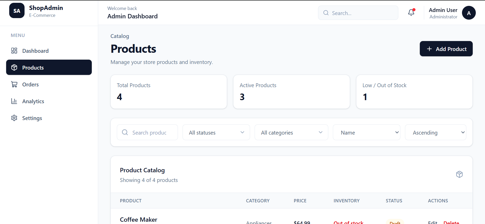

# E-Commerce Admin & Real-Time Analytics Dashboard

A responsive e-commerce administration dashboard built with **React, TypeScript, and Vite**. It provides an interface for monitoring store performance, managing products, handling orders, and viewing analytics.

## Project Status

**Frontend implementation complete.**

The dashboard currently uses mock data and client-side functionality. It is not connected to a production backend or database.

## Features

- **Dashboard Overview:** View key store metrics, sales summaries, and recent orders.
- **Product Management:** View, add, edit, and delete products.
- **Order Management:** View order details and update order statuses.
- **Analytics:** Explore sales and product performance using mock data.
- **Responsive Design:** Optimized layouts for desktop and mobile devices.
- **Form Validation:** Validate user input when managing products and settings.
- **Client-Side Persistence:** Product records and settings use localStorage where implemented.
- **Accessible Navigation:** Keyboard-friendly navigation and responsive menu controls.
- **Error Handling:** React error boundaries help handle unexpected application errors.
- **Automated Testing:** Unit and component tests using Vitest and React Testing Library.

## Tech Stack

| Technology | Purpose |
|---|---|
| React 19 | User interface |
| TypeScript | Type safety |
| Vite | Development server and build tool |
| React Router 7 | Application routing |
| TanStack Query v5 | Data fetching and state management |
| Tailwind CSS v4 | Styling |
| shadcn/ui with Base UI | UI components |
| Lucide React | Icons |
| Vitest | Testing |
| React Testing Library | Component testing |
| MSW | API mocking |
| ESLint | Code quality and linting |

## Getting Started

### Prerequisites

Make sure you have the following installed:

- [Node.js](https://nodejs.org/)
- npm
- [Git](https://git-scm.com/)

### Installation

1. Clone the repository:

   ```bash
   git clone https://github.com/MiMi-Tech19/ecommerce-admin-dashboard.git
   ```

2. Navigate into the project directory:

   ```bash
   cd ecommerce-admin-dashboard
   ```

3. Install dependencies:

   ```bash
   npm install
   ```

4. Start the development server:

   ```bash
   npm run dev
   ```

5. Open the local development URL displayed in your terminal (usually `http://localhost:5173`).

## Available Scripts

| Command | Description |
|---|---|
| `npm run dev` | Starts the development server |
| `npm run build` | Runs TypeScript checks and creates a production build |
| `npm run lint` | Runs ESLint |
| `npm run test:run` | Runs the automated test suite |

## Testing and Quality Assurance

The project has been checked using the following commands:

```bash
npm run test:run
npm run lint
npm run build
```

**Latest recorded verification:**

- 73 automated tests passed across 16 test files.
- ESLint completed successfully.
- Production build completed successfully.

## Data and Persistence

The dashboard currently operates with mock data rather than a live production API.

- **Products:** Product records use localStorage where implemented.
- **Settings:** Settings use localStorage where implemented.
- **Orders:** Order status changes are held in application memory and reset when the page is refreshed.
- **Analytics:** Analytics information is generated from mock data.

A production backend and database would be required to support shared, persistent updates and real-time store analytics.

## Responsive Design

The interface is designed to work across different screen sizes.

- Desktop layouts use tables for structured information.
- Mobile layouts use responsive cards where appropriate.
- Navigation adapts to smaller screens.
- Keyboard-friendly interactions support accessibility.

## Future Improvements

Potential next steps include:

- Connect the dashboard to a production API and database.
- Implement persistent order management.
- Integrate real-time sales and business analytics.
- Add authentication and role-based access control.
- Expand automated test coverage.

## Project Links

- **GitHub Repository:** [E-Commerce Admin Dashboard](https://github.com/MiMi-Tech19/ecommerce-admin-dashboard)

- **Live Demo:** [View Live Dashboard](https://ecommerce-admin-dashboard-r9nm28jvw-mi-mi-tech19.vercel.app/)

> **Note:** Use the Vercel Shareable Link configured to allow access to anyone with the link. The ordinary protected deployment URL may redirect visitors to Vercel login.

## Screenshots

### Dashboard Overview


### Product Management



### Order Management


## Author

Developed as part of the **AltSchool Africa Frontend Engineering programme**.