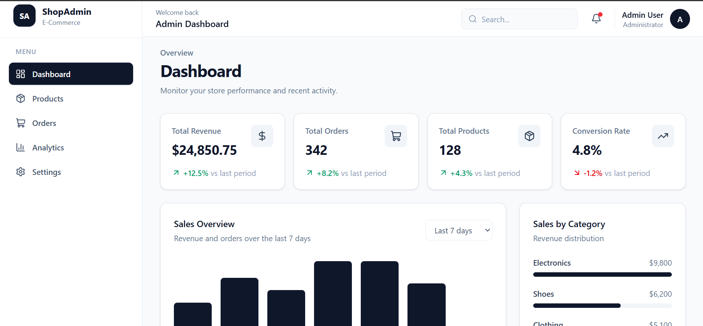

# E-Commerce Admin & Real-Time Analytics Dashboard

A responsive e-commerce administration dashboard built with React, TypeScript, and Vite. The application provides an interface for monitoring store performance, managing products, and handling customer orders.

> **Project status:** Frontend implementation with mock data. A production backend and database are not currently connected.

## Features

- **Dashboard overview:** View store analytics and recent orders.
- **Product management:** View, add, edit, and delete products.
- **Order management:** View order details and update order statuses.
- **Analytics:** Explore dashboard metrics using mock data.
- **Responsive design:** Mobile-friendly layouts for dashboard, product, and order views.
- **Form validation:** Validate product details and display helpful error messages.
- **Client-side persistence:** Product records and settings persist through browser `localStorage` where implemented.
- **Accessible navigation:** Keyboard-accessible controls and responsive mobile navigation.
- **Error handling:** Improved error handling using React error boundaries.
- **Automated testing:** Unit and component tests using Vitest and React Testing Library.

## Tech Stack

- **React 19** — Component-based user interface
- **TypeScript** — Type safety
- **Vite** — Development server and build tooling
- **React Router 7** — Application routing
- **TanStack Query v5** — Data-fetching and server-state utilities
- **Tailwind CSS v4** — Styling and responsive layouts
- **shadcn/ui with Base UI** — UI components
- **Lucide React** — Icons
- **Vitest** — Testing framework
- **React Testing Library** — Component testing
- **MSW** — API mocking for tests
- **ESLint** — Code quality and linting

## Getting Started

### Prerequisites

Install the following before running the project:

- [Node.js](https://nodejs.org/)
- npm, included with Node.js
- Git, if cloning the repository

### Installation

1. Clone the repository or open your existing project folder.
2. Open a terminal in the project root.
3. Install the dependencies:

   ```bash
   npm install
   ```

### Run the Development Server

```bash
npm run dev
```

Open the local URL displayed in your terminal, usually `http://localhost:5173`.

## Available Scripts

Run these commands from the project root.

| Command | Description |
|---|---|
| `npm run dev` | Start the development server |
| `npm run build` | Type-check and build the production application |
| `npm run lint` | Run ESLint checks |
| `npm run test:run` | Run the automated test suite once |

## Testing and Quality Assurance

The project uses Vitest and React Testing Library to test application behavior and components. MSW is available for mocking API requests in tests.

Before deployment, run:

```bash
npm run test:run
npm run lint
npm run build
```

All three checks passed during the latest development verification.

## Data and Persistence

The current implementation uses mock data rather than a connected production backend.

- **Products and settings:** Persist in browser `localStorage` where implemented.
- **Order status changes:** Currently held in application memory and reset when the page is refreshed.
- **Analytics:** Use mock data and do not represent live store transactions.

A backend and database integration would be needed for shared, persistent order updates and real-time analytics across users and devices.

## Responsive Design

The dashboard supports desktop and mobile layouts. Product and order tables are presented on larger screens, while mobile layouts use cards to improve readability and avoid unnecessary horizontal scrolling.

Keyboard navigation and the mobile hamburger menu have also been checked during accessibility testing.

## Future Improvements

- Integrate a production API and database.
- Persist order status changes.
- Connect analytics to real store data.
- Add authentication and role-based access control.
- Add further automated tests as the application grows.

## Project Links

- **Live Demo:** [View E-Commerce Admin Dashboard](https://ecommerce-admin-dashboard-immg2arg9-mi-mi-tech19.vercel.app/)
- **Source Code:** [GitHub Repository](https://github.com/MiMi-Tech19/ecommerce-admin-dashboard)

## Screenshots

### Dashboard Overview



### Product Management


### Order Management


## Author

Developed as part of an AltSchool Africa frontend development project, with a focus on responsive UI design, TypeScript, component testing, and maintainable React architecture.
